# Permainan Catur Dua Pemain dengan Lawan Komputer (Negamax Alpha-Beta), Antarmuka Mouse PS/2, dan Tampilan VGA 800x600 Berbasis VHDL-2008 pada FPGA Digilent Basys 3

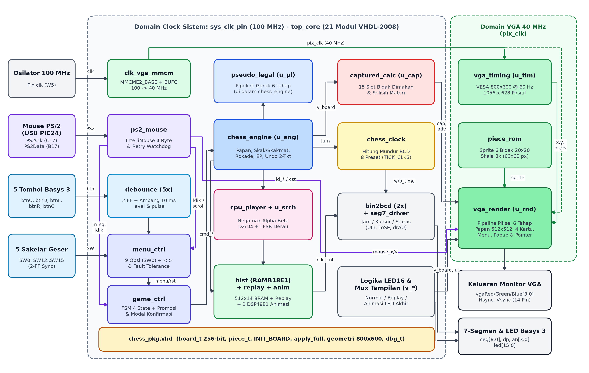

Proyek akhir mata kuliah **Sistem Digital Lanjut** (Kelompok 5, Program Studi Teknik Komputer, Fakultas Ilmu Komputer, Universitas Brawijaya, 2026). Implementasi permainan catur lengkap berbasis **VHDL-2008** pada papan FPGA **Digilent Basys 3** (`xc7a35t-1cpg236c`) dengan keluaran **SVGA 800x600 @ 60 Hz**, kendali **Mouse PS/2 IntelliMouse** (dengan fallback otomatis ke tombol tekan Basys 3), mesin aturan catur penuh, serta lawan komputer algoritma **Negamax Alpha-Beta**.

## 1. Identitas Proyek & Tim Pengembang

- **Institusi:** Program Studi Teknik Komputer, Fakultas Ilmu Komputer, Universitas Brawijaya (2026)
- **Dosen Pengampu:** Nur Hazbiy Shaffan, S.T., M.T.
- **Target Perangkat:** Digilent Basys 3 (`xc7a35t-1cpg236c`), Vivado 2026.1, VHDL-2008
- **Komposisi Kode Sumber:** 21 berkas RTL (`4.749` baris), 5 berkas testbench XSim (`738` baris), 1 berkas XDC (`72` baris / 55 pin IOB)
- **Laporan Akhir Lengkap:** [Laporan_Proyek_Akhir_SDL_Kelompok_5_Final_Rapi.pdf](docs/Laporan_Proyek_Akhir_SDL_Kelompok_5_Final_Rapi.pdf)

| No | Nama Anggota Kelompok 5 | NIM |
| :---: | :--- | :--- |
| 1 | Arva Mada Jayastu | `255150300111053` |
| 2 | Fristian Boas Nathaniel | `255150301111006` |
| 3 | Nabila Safitri | `255150301111008` |
| 4 | Anugerah Bhumi Nalaputra | `255150301111011` |
| 5 | Tertia Najwa Tabitha | `255150301111012` |
| 6 | Farrel Arzaqia Mecca | `255150301111027` |
| 7 | Kamilla Ulfa Berlian Rosyida | `255150307111082` |

---

## 2. Fitur Utama & Arsitektur Sistem

### Arsitektur Dua Domain Clock
- **Domain Sistem Utama (`100 MHz` / `sys_clk_pin`):** Menjalankan mesin aturan catur (`chess_engine`), pencari langkah AI (`cpu_player` dengan instans bayangan `u_srch`), memori riwayat BRAM (`hist`), jam catur BCD (`chess_clock`), penerima paket PS/2 (`ps2_mouse`), pengelola kontrol/menu (`game_ctrl`, `menu_ctrl`), dan kalkulator bidak dimakan (`captured_calc`).
- **Domain Video VGA (`40,000 MHz` / `pix_clk`):** Dibangkitkan langsung dari osilator 100 MHz melalui primitif internal `MMCME2_BASE` (`VCO = 800 MHz`, pembagi `20`) di dalam `clk_vga_mmcm.vhd` tanpa file IP `.xci`, menggerakkan sinyal SVGA VESA `800x600 @ 60 Hz` (`1056 x 628` total piksel/baris) serta pipeline perender 6 tahap (`P1` sampai `P6`) di `vga_render.vhd`.

### Fitur Permainan & Antarmuka
- **Aturan Catur Resmi Lengkap:** Gerak 6 jenis bidak (`P`, `N`, `B`, `R`, `Q`, `K`), rokade sisi raja maupun sisi menteri, *en passant*, promosi pion ke 4 pilihan (`RATU`, `BENT`, `GAJ`, `KUDA`) lewat dialog popup interaktif, deteksi *skak*, *skakmat*, *pat* (stalemate), serta *undo* hingga 2 tingkat ke belakang lewat memori riwayat 511 langkah.
- **Lawan Komputer (`cpu_player`):** Algoritma *Negamax* dengan *alpha-beta pruning* pada stack register perangkat keras hingga 8 tingkat:
  - **Tingkat 1:** Kedalaman `2 ply` dengan variasi derau LFSR 16-bit (`0..15` sentipion) untuk variasi pembukaan.
  - **Tingkat 2:** Kedalaman `4 ply` deterministik dengan pencarian taktis yang lebih dalam.
- **Tampilan SVGA 800x600 (`vga_render`):**
  - Papan catur `512x512` (`64x64` piksel per petak, sprite `20x20` dari `piece_rom` diperbesar 3x), label koordinat `A-H` dan `1-8`, serta animasi luncur bidak 16 bingkai (`anim`).
  - Panel kanan 4 kartu berbingkai: (1) kartu giliran, mode bermain, dan status (*Skak* berkedip, *Skakmat*, *Pat*, *CPU Berpikir*), (2) jam catur BCD 8 preset (`OFF`, `1M`, `3M`, `5M`, `10M`, `15M`, `30M`, `60M`), (3) kartu baki bidak dimakan (hingga 15 ikon mini `20x20` per warna + selisih nilai materi `+N`) dari `captured_calc`, serta (4) kartu indikator `MOUSE: OK` / `MOUSE: OFF` dan legenda pintasan dinamis.
  - Empat popup overlay terpusat: Menu Pengaturan 9 opsi (`SW0`), Popup Promosi 4 Ikon, Popup Konfirmasi (`[ YA ]` / `[ TIDAK ]`), dan Popup Akhir Permainan (`[MAIN LAGI]` / `[CEK PAPAN]`).
- **Mouse PS/2 IntelliMouse & Fault Tolerance (`ps2_mouse` + `menu_ctrl`):** Mendukung inisialisasi 4-byte IntelliMouse (gerakan XY, klik kiri/kanan, dan roda gulir), watchdog hot-plug, fallback otomatis ke 3-byte PS/2 standar maupun ke mode 5 tombol tekan papan (`MOUSE: OFF`) saat mouse dilepas, serta klik baris menu yang bebas *hover-override* (klik pertama menyorot baris dan menampilkan panah `< >`, klik berikutnya mengubah nilai).

### Struktur Direktori & 21 Modul RTL

```text
.
├── .gitignore
├── README.md
├── constraints/
│   └── basys3_chess_mouse.xdc
├── docs/
│   ├── Laporan_Proyek_Akhir_SDL_Kelompok_5_Final_Rapi.pdf
│   └── images/                      # Diagram arsitektur, hasil XSim, Vivado, dan foto demo Basys 3
├── rtl/                             # 21 berkas sumber VHDL-2008 (4.749 baris)
├── scripts/
│   ├── setup_vivado.tcl             # Skrip otomatis setup proyek Vivado (xc7a35tcpg236-1, VHDL-2008)
│   └── run_xsim.ps1                 # Skrip PowerShell untuk menjalankan 4 testbench XSim
└── sim/                             # 5 berkas testbench VHDL-2008 (738 baris)
```

| Kelompok | Berkas RTL | Baris | Peran Utama |
| :--- | :--- | :---: | :--- |
| **Paket & Utilitas** | `chess_pkg.vhd`, `debounce.vhd`, `bin2bcd.vhd`, `seg7_driver.vhd` | 380 | Konstanta geometri 800x600 & hitbox UI, tipe papan 256-bit, peredam pantulan tombol 10 ms, konversi BCD, dan driver 7-segmen |
| **Clock & VGA Timing** | `clk_vga_mmcm.vhd`, `vga_timing.vhd` | 118 | Pembangkit clock piksel eksak `40,000 MHz` via `MMCME2_BASE` (dengan `SIM_BYPASS` untuk XSim) serta pencacah VESA `1056 x 628` |
| **Mesin Aturan & AI** | `pseudo_legal.vhd`, `chess_engine.vhd`, `cpu_player.vhd` | 860 | Validator gerak pipeline 6 tahap, FSM mesin catur 21 keadaan (snapshot 293-bit 2 tingkat), dan AI Negamax Alpha-Beta |
| **Riwayat, Jam & Status** | `hist.vhd`, `replay.vhd`, `chess_clock.vhd`, `captured_calc.vhd`, `anim.vhd` | 476 | Memori BRAM 512x14, kontrol ulang tayang langkah, timer hitung mundur BCD, kalkulator baki bidak dimakan + kompensasi promosi, dan interpolator animasi |
| **Kendali & Antarmuka** | `ps2_mouse.vhd`, `menu_ctrl.vhd`, `game_ctrl.vhd` | 939 | Transceiver PS/2 IntelliMouse 4-byte + watchdog, pengelola Menu Pengaturan 9 opsi bebas *hover-override*, dan FSM input hibrida mouse/tombol |
| **Perender & Integrasi** | `piece_rom.vhd`, `vga_render.vhd`, `top_core.vhd`, `top.vhd` | 1.976 | ROM sprite 6 bidak (`20x20` 2-bpp), pipeline perender VGA 6 tahap (`P1..P6`), interkoneksi 21 modul (`top_core`), dan wrapper pin fisik Basys 3 (`top`) |

---

## 3. Panduan Pengendalian Fisik Basys 3 & Mouse PS/2

| Input Fisik | Kondisi / Mode | Fungsi pada Sistem |
| :--- | :--- | :--- |
| **`SW0`** (`V17`) | Selalu aktif | Membuka / menutup overlay Menu Pengaturan 9 opsi (`MODE`, `CPU LVL`, `WAKTU`, `TEMA`, `HINT`, `ANIMASI`, `JEDA JAM`, `7-SEGMEN`, `REPLAY`) |
| **`SW12`** (`W2`) | Rising edge | Membatalkan langkah (*Undo* 1 langkah pada mode 2 pemain, atau 2 langkah pada mode CPU) |
| **`SW13`** (`U1`) | Rising edge | Membuka popup konfirmasi **TAWARAN REMIS?** (`[ YA ]` / `[ TIDAK ]`) |
| **`SW14`** (`T1`) | Rising edge | Membuka popup konfirmasi **YAKIN MENYERAH?**, atau menampilkan/menyembunyikan popup Game Over saat cek papan |
| **`SW15`** (`R2`) | Selalu aktif | Reset penuh permainan ke posisi awal |
| **Mouse USB/PS2** | `MOUSE: OK` | Gerak pointer 12x12; klik kiri pilih/jalan/klik item menu & tombol popup; klik kanan batal pilih/keluar promosi; scroll atas/bawah mengganti nilai menu, pilihan promosi, atau langkah replay |
| **`BTNL / BTNR / BTND / BTNU`** | `MOUSE: OK` (saat bermain) | Pintasan papan langsung: `BTNL` = Undo, `BTNR` = Remis, `BTND` = Menyerah / Popup Game Over, `BTNU` = Jeda / Lanjut Jam |
| **`BTNU / BTND / BTNL / BTNR / BTNC`** | `MOUSE: OFF` atau di dalam menu | Kendali kursor papan 8x8 & pilih/jalan (`BTNC`), navigasi menu 9 opsi (`BTNU/D` pindah baris, `BTNL/R` ubah `< >`), dan navigasi tombol popup |
| **7-Segmen (`seg[6:0]`, `an[3:0]`, `dp`)** | Dinamis | Menampilkan waktu sisa giliran aktif (`MM:SS`), koordinat kursor & bidak terpilih saat `WAKTU OFF`/`7-SEGMEN: KURSOR`, serta kode hasil akhir (`UIn`, `LoSE`, `drAU`, `P1`, `P2`) |
| **LED (`led[15:0]`)** | Dinamis | Indikator giliran, status skak/skakmat/pat, *CPU berpikir* (`LED13`), *replay* (`LED14`), *animasi* (`LED15`), serta pola kedip saat permainan berakhir |

---

## 4. Cara Build & Pemrograman di Vivado 2026.1

1. Buat proyek RTL baru di **Vivado 2026.1** dengan target part `xc7a35tcpg236-1` (Digilent Basys 3) tanpa menambahkan berkas apa pun terlebih dahulu.
2. Buka **Tcl Console** di Vivado, pindah ke direktori root repositori ini (`cd <path-ke-repo>`), lalu jalankan skrip penyiapan otomatis:
   ```tcl
   source scripts/setup_vivado.tcl
   ```
   Skrip tersebut otomatis menambahkan seluruh 21 berkas `rtl/*.vhd`, 5 berkas `sim/*.vhd`, dan `constraints/basys3_chess_mouse.xdc`, menyetel `file_type {VHDL 2008}`, menetapkan `top` sebagai *Top Module*, dan menempatkan `rtl/chess_pkg.vhd` di urutan kompilasi pertama.
   *(Jika menambah berkas secara manual melalui GUI Vivado, pastikan menjalankan `set_property file_type {VHDL 2008} [get_files *.vhd]` sebelum Synthesis maupun Simulation.)*
3. Jalankan **Run Synthesis**, **Run Implementation**, lalu **Generate Bitstream** hingga berstatus `write_bitstream Complete`.
4. Hubungkan papan Digilent Basys 3 (beserta monitor VGA 800x600 pada port VGA dan mouse USB HID/PS2 pada port USB host Basys 3), buka **Open Hardware Manager -> Open Target -> Auto Connect**, lalu klik **Program Device** dengan berkas `top.bit`.

---

## 5. Cara Menjalankan Simulasi (Vivado XSim & GHDL)

### Simulasi Antarmuka 800x600 & Mouse PS/2 (Vivado 2026.1 XSim)
Untuk menjalankan seluruh 4 testbench *self-checking* di Windows PowerShell secara otomatis menggunakan skrip bantu (hasil kompilasi XSim ditempatkan di folder `%TEMP%` sehingga repositori tetap bersih):

```powershell
powershell -ExecutionPolicy Bypass -File .\scripts\run_xsim.ps1
```

Atau secara manual melalui Vivado CLI (`xvhdl`, `xelab`, `xsim`):

```powershell
xvhdl --2008 rtl/chess_pkg.vhd rtl/debounce.vhd rtl/clk_vga_mmcm.vhd rtl/vga_timing.vhd rtl/hist.vhd rtl/chess_clock.vhd rtl/bin2bcd.vhd rtl/seg7_driver.vhd rtl/pseudo_legal.vhd rtl/chess_engine.vhd rtl/cpu_player.vhd rtl/replay.vhd rtl/anim.vhd rtl/captured_calc.vhd rtl/ps2_mouse.vhd rtl/menu_ctrl.vhd rtl/game_ctrl.vhd rtl/piece_rom.vhd rtl/vga_render.vhd rtl/top_core.vhd rtl/top.vhd sim/tb_util.vhd sim/tb_captured_calc.vhd sim/tb_ps2_mouse.vhd sim/tb_menu_ctrl.vhd sim/tb_mouse_sys.vhd

xelab work.tb_captured_calc -L unisim -s tb_captured_calc_sim && xsim tb_captured_calc_sim -runall
xelab work.tb_ps2_mouse     -L unisim -s tb_ps2_mouse_sim     && xsim tb_ps2_mouse_sim     -runall
xelab work.tb_menu_ctrl     -L unisim -s tb_menu_ctrl_sim     && xsim tb_menu_ctrl_sim     -runall
xelab work.tb_mouse_sys     -L unisim -s tb_mouse_sys_sim     && xsim tb_mouse_sys_sim     -runall
```

| Testbench XSim | Durasi Simulasi | Cakupan Verifikasi | Status |
| :--- | :---: | :--- | :---: |
| `tb_captured_calc` | `76 ns` | Papan awal (`0`), makan Q+R+P (`+15`), kompensasi promosi pion ke Ratu ke-2 (`+8`), pemulihan Undo | `PASS` |
| `tb_ps2_mouse` | `371.055 ns` | Handshake 9 perintah IntelliMouse (`0xFF..0xF4`, ID `0x03`), koordinat & `clamp` 800x600, klik/scroll, fallback 3-byte (`0x00`) | `PASS` |
| `tb_menu_ctrl` | `246 ns` | Reset startup 4 clock, anti-hover-override, klik baris vs klik `< / >`, *wrap* 9 opsi, auto-reset preset waktu | `PASS` |
| `tb_mouse_sys` | `923.825 ns` | Simulasi serempak dua instans `top_core`: `dut` bermouse penuh (menu SW0, `1.e4 d5 2.exd5`, `BTNL` Undo, `BTND` Menyerah, `[CEK PAPAN]`/`[MAIN LAGI]`, keluaran VGA bebas `X/U`) dan `dut_fb` tanpa mouse (`BTNU/C` + `SW12`) | `PASS` |

### Ringkasan Verifikasi Inti (GHDL 4.1.0 melawan `python-chess`)
Lapisan logika catur inti telah diverifikasi sebelumnya pada GHDL 4.1.0 menggunakan vektor acuan `python-chess` tanpa satu pun kegagalan:
- **`tb_engine`:** 200 posisi uji (`12.800` topeng tujuan legal, `766` eksekusi langkah & *undo*, status skak/skakmat/pat, dan `734` kombinasi `cmd_smake`/`cmd_chk`), plus deteksi `12/12` mutan kesalahan buatan.
- **`tb_cpu`:** 53 posisi Negamax Alpha-Beta (28 posisi kedalaman 2 tanpa derau, 14 posisi dengan derau LFSR, 8 posisi kedalaman 3, dan 3 posisi kedalaman 4) cocok dengan referensi Python.
- **`tb_clock`, `tb_replay`, `tb_sys`, `tb_frames`:** 10 kasus uji jam BCD, ulang tayang partai 120 & 450 langkah tanpa selisih papan, 6 skenario sistem tombol, dan pembandingan piksel demi piksel 9 bingkai VGA terhadap acuan Verilog (`0` piksel berbeda).

---

## 6. Hasil Implementasi Perangkat Keras & Galeri Demo

### Ringkasan Pasca-Place & Route Vivado 2026.1 (`xc7a35t-1cpg236c`)

Seluruh `21.725` net terutekan penuh (`0` galat rute; `0` DRC Error) menghasilkan berkas `top.bit` berukuran `2.192.206` byte.

| Parameter Implementasi | Hasil Aktual | Keterangan |
| :--- | :--- | :--- |
| **Slice LUTs** | `19.109 / 20.800` (`91,87%`) | `18.785` LUT as Logic (`90,31%`), `324` LUT as Memory (`3,38%`: `272` Distributed RAM + `52` Shift Register) |
| **Slice Registers (Flip-Flop)** | `5.236 / 41.600` (`12,59%`) | `4.909` FDRE + `327` FDSE; `0` Latch; `5.286` Slice (`64,86%`) |
| **Block RAM Tile (`BRAM`)** | `0,5 / 50` (`1,00%`) | Tepat `1 RAMB18E1` pada `u_hist` (`512 x 14` bit) |
| **DSPs (`DSP48E1`)** | `2 / 90` (`2,22%`) | Dipetakan untuk interpolasi animasi `u_an` |
| **Clocking & I/O** | `1` `MMCME2_ADV`, `3` `BUFGCTRL`, `55` IOB (`51,89%`) | `42` OBUF, `11` IBUF, `2` IOBUF (PS/2 dengan `PULLUP`) |
| **Daya On-Chip Total** | `0,365 W` (`26,8 °C`) | `0,293 W` Dinamis (`80%`: MMCM `0,095 W`, Signals `0,080 W`, Logic `0,058 W`, Clocks `0,031 W`, I/O `0,028 W`) + `0,072 W` Statis (`20%`); margin termal `58,2 °C` (`Confidence Level: Low` karena analisis vectorless tanpa SAIF) |
| **Timing Domain VGA `40 MHz`** | `WNS = +12,692 ns`, `WHS = +0,077 ns` | **LULUS (`MET`)** pada seluruh `907` endpoint perender VGA 800x600 |
| **Timing Lintas Domain Clock** | `+2,660 ns` (`pix -> sys`) & `+0,514 ns` (`sys -> pix`) | **LULUS (`MET`)** dua arah (`0` gagal dari `630` endpoint) |
| **Timing Domain `100 MHz` (`sys_clk_pin`)** | `WHS = +0,059 ns` (LULUS), `WNS = -38,599 ns` (Setup) | Pelanggaran setup terlokalisasi di jalur kombinasional kuasi-statis modul `captured_calc` (`4.934` endpoint; jalur kritis `70` tingkat logika dengan data delay `48,537 ns` menuju `core/u_cap/cap_by_b_reg[44]/D`). Karena `v_board` hanya berubah setiap langkah catur (jeda ratusan ms), keluaran `captured_calc` stabil dalam ~50 ns jauh sebelum pemindaian frame VGA berikutnya dan terbukti berjalan akurat pada Basys 3 |
| **Messages & DRC Vivado** | `0` Error, `2` Critical Warning, `110` Warning | Kedua Critical Warning merujuk `[Timing 38-282]` (`impl_1` + `Open Implemented Design`). `110` Warning terdiri atas `106` peringatan sintesis (`Synth 8-3917/6040/3936`), `2` implementasi (`Route 35-328`, `Power 33-332`), dan `2` GUI/Hardware Manager (`Project 1-5713`, `Labtoolstcl 44-129`). `Report DRC` pasca-route menghasilkan `0` Error dan `6` warning pipeline DSP (`DPIP-1`, `DPOP-1`, `DPOP-2`) pada `u_an` |

### Galeri Simulasi Vivado XSim & Implementasi FPGA

| Menu Pengaturan (`SW0`) & Hint XSim | Popup Promosi Pion (XSim) | Skakmat & Game Over (XSim) |
| :---: | :---: | :---: |
| 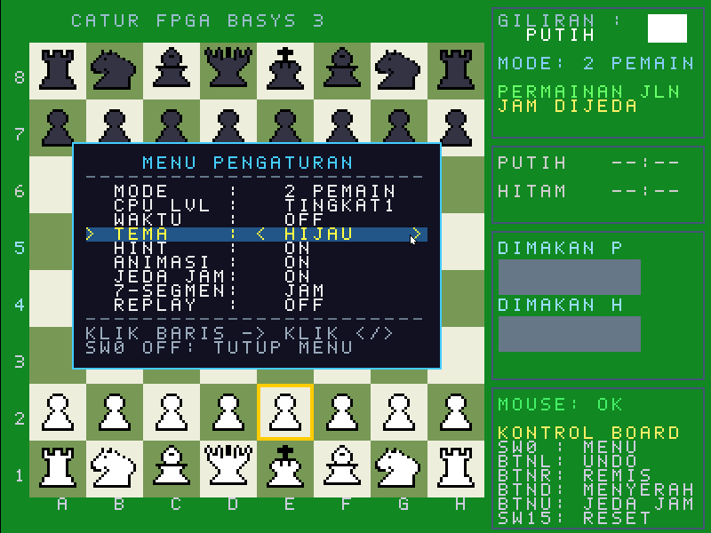 | 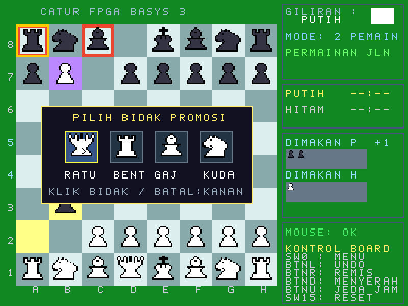 | 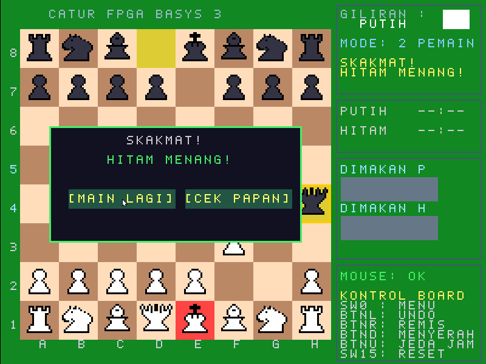 |

| Vivado Utilization (`19.109` LUT / `91,87%`) | Vivado Design Timing Summary | Vivado Report Power (`0,365 W`) & Messages |
| :---: | :---: | :---: |
| 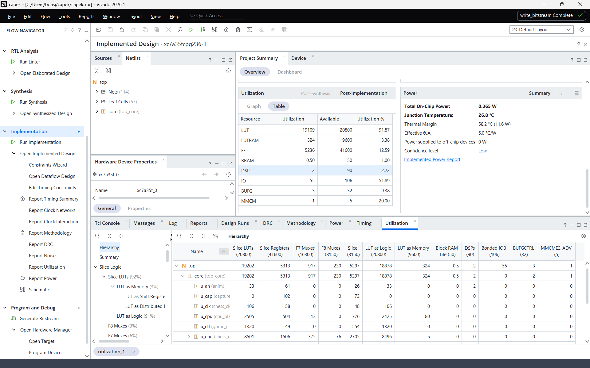 | 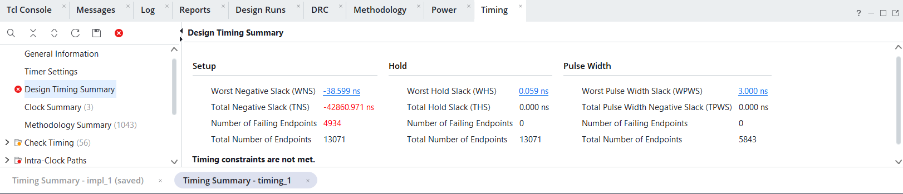 | 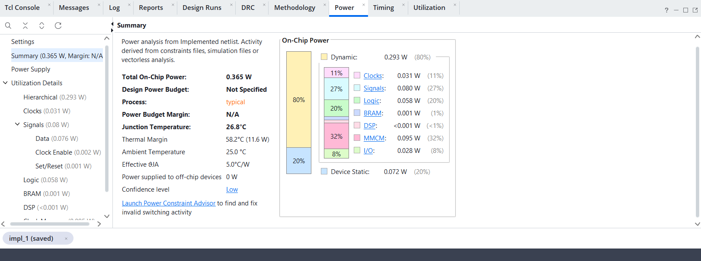 |

### Galeri Pengujian Langsung Basys 3 + Monitor VGA 800x600

| Menu Pengaturan 9 Opsi (`SW0`) | Petunjuk Langkah Legal (Hint) |
| :---: | :---: |
| 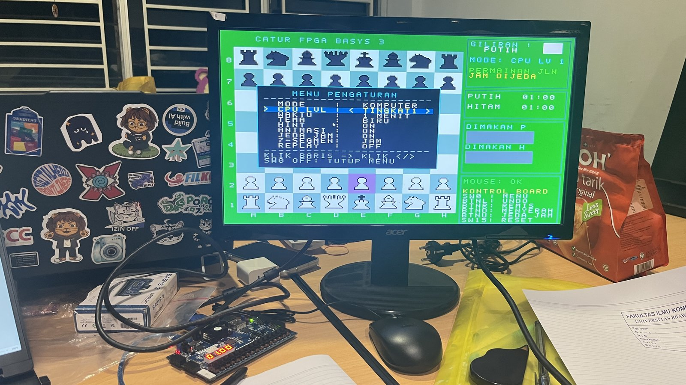 | 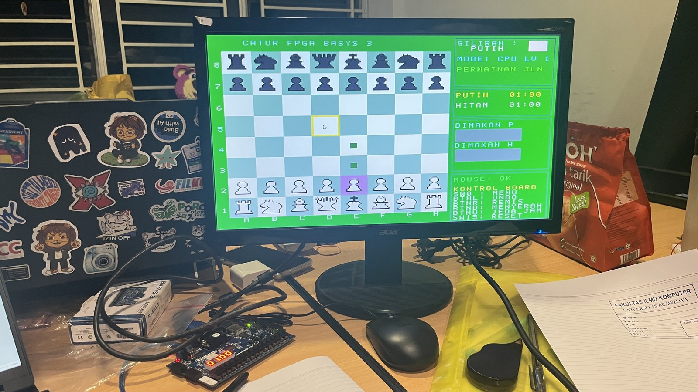 |

| Popup Promosi Pion 4 Ikon (`RATU`, `BENT`, `GAJ`, `KUDA`) | Skakmat Lawan Komputer Tingkat 2 (`LoSE` di 7-Segmen) |
| :---: | :---: |
| 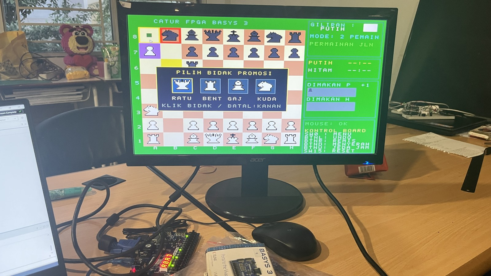 | 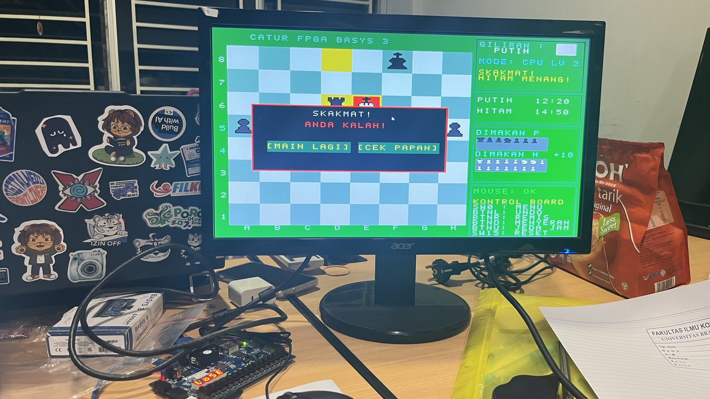 |
